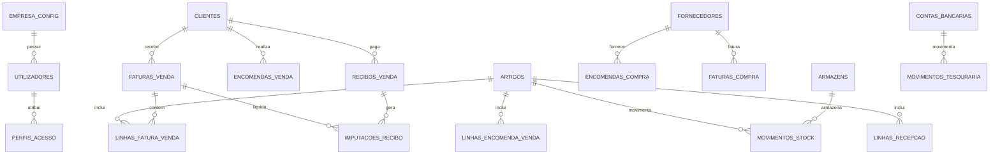

# Especificação Técnica e Modelagem de Dados — DoraERP

Este documento apresenta a análise completa dos formulários, o levantamento de **Regras de Negócio (RN)**, **Requisitos Funcionais (RF)**, **Requisitos Não-Funcionais (RNF)** e a **Modelagem do Banco de Dados Relacional (DB Schema)** para a implementação do backend e da camada de persistência do DoraERP.

---

## 1. Visão Geral da Arquitetura

O **SocTechno** é um sistema ERP de gestão empresarial focado em conformidade fiscal (Angolana), automação comercial, recursos humanos, gestão de inventário e tesouraria.

- **Frontend:** React (TypeScript) + Tailwind CSS + Lucide Icons + React Hook Form + Zod.
- **Camada Desktop:** Electron IPC.
- **Banco de Dados Proposto:** SQLite (para versão local/offline standalone) ou PostgreSQL (para versão cliente-servidor em rede).

---

## 2. Requisitos Não-Funcionais (RNF)

- **RNF01 - Desempenho e Latência:** O tempo de resposta para gravação de documentos e consultas locais deve ser inferior a 100ms.
- **RNF02 - Integridade e Imutabilidade Fiscal:** Documentos fiscais emitidos (Faturas, Notas de Crédito, Recibos) não podem ser alterados ou apagados (`DELETE`), apenas anulados através da emissão de documento retificativo (Nota de Crédito/Débito), garantindo auditabilidade SAF-T.
- **RNF03 - Segurança e Acesso Baseado em Perfis (RBAC):** Cada utilizador possui um perfil de acesso (`Administrador`, `Operador`, `Financeiro`, `Vendedor`) que restringe as permissões de leitura, escrita e aprovação nos módulos.
- **RNF04 - Auditabilidade (Audit Log):** Todas as operações de criação, alteração ou anulação de registos sensíveis devem gravar automaticamente um registo de auditoria com `user_id`, `timestamp`, `action` e `ip_address`.
- **RNF05 - Suporte Multimoeda e Multi-região Fiscal:** O sistema deve suportar operações em `EUR`, `AOA` e `USD`, bem como adaptação ao regime fiscal de Portugal (Autoridade Tributária - AT) e Angola (Administração Geral Tributária - AGT).
- **RNF06 - Validação Estrita de Dados:** Todos os dados devem ser validados na camada de apresentação (Schemas Zod) e na camada de persistência (Constraints SQL `NOT NULL`, `FOREIGN KEY`, `CHECK`, `UNIQUE`).

---

## 3. Requisitos Funcionais (RF) e Regras de Negócio (RN) por Módulo

### 3.1 Módulo Master Data (Artigos, Entidades e Organização)

#### [RF01] Cadastro Unificado de Artigos (Master Data 360°)
- **Descrição:** Permite gerir a ficha completa de artigos (comercial, estoque e custeio).
- **Regras de Negócio (RN):**
  - **RN01.1 (Unicidade de SKU e EAN):** O `codigo` (SKU) deve ser único globalmente. O `codigoBarras` (EAN) deve ser único quando preenchido.
  - **RN01.2 (Regra de Serviços):** Se `tipo = 'servico'`, o sistema deve desativar automaticamente movimentações físicas de estoque, controlo por lote e definição de armazém padrão.
  - **RN01.3 (Atualização de Custo Médio):** O `precoCustoMedio` (PMP) deve ser recalculado automaticamente a cada Guia de Receção ou Fatura de Compra aprovada.
  - **RN01.4 (Unidades de Medida):** A unidade base deve pertencer ao conjunto padronizado: `UN`, `KG`, `L`, `CX`, `M`, `M²`, `M³`.

#### [RF02] Cadastro de Clientes e Fornecedores
- **Descrição:** Registo e manutenção de fichas de entidades terceiras.
- **Regras de Negócio (RN):**
  - **RN02.1 (Validação de NIF):** O NIF deve ser validado conforme o país da entidade (ex: algoritmo NIF de Portugal ou NIF/NIF Empresa de Angola).
  - **RN02.2 (Verificação de Limite de Crédito):** Na criação de uma encomenda ou fatura pendente, o sistema deve impedir a emissão se `saldo_devedor_atual + valor_documento > limiteCredito`.

---

### 3.2 Módulo de Vendas e Faturação

#### [RF03] Emissão de Faturas (FT, FR, NC, ND)
- **Descrição:** Emissão de documentos de venda e notas de crédito/débito.
- **Regras de Negócio (RN):**
  - **RN03.1 (Numeração Sequencial sem Lacunas):** A numeração do documento (`numero`) deve ser gerada automaticamente por série/ano fiscal (ex: `FT 2026/0001`) em sequência estrita ininterrupta.
  - **RN03.2 (Snapshot de Dados Fiscais):** Os dados fiscais do cliente (Nome, NIF, Endereço Fiscal) devem ser gravados em "snapshot" no cabeçalho da fatura no momento da emissão, permanecendo inalterados mesmo se a ficha do cliente for atualizada posteriormente.
  - **RN03.3 (Motivo de Isenção de IVA):** Se qualquer linha contiver `taxaIva = 0`, o campo `motivoIsencao` torna-se **obrigatório**.
  - **RN03.4 (Chave Hash e ATCUD):** Cada documento emitido deve gerar a assinatura de hash criptográfica (RSA-SHA1/SHA256) e o código único de documento (ATCUD).

#### [RF04] Emissão e Imputação de Recibos
- **Descrição:** Registo de pagamentos efetuados por clientes.
- **Regras de Negócio (RN):**
  - **RN04.1 (Imputação de Saldo):** A soma das imputações (`SUM(valor)`) não pode exceder o `valorRecebido` no recibo nem o saldo pendente de cada fatura associada.
  - **RN04.2 (Atualização de Estado de Pagamento):** Ao liquidar uma fatura, o seu `estadoPagamento` deve transitar automaticamente de `pendente` para `pago` (ou `parcial`).

---

### 3.3 Módulo de Compras e Logística de Entrada

#### [RF05] Encomendas e Receção de Fornecedores
- **Descrição:** Emissão de ordens de compra e registo de guias de entrada de material.
- **Regras de Negócio (RN):**
  - **RN05.1 (Entrada Física de Stock):** A confirmação de uma Guia de Receção incrementa automaticamente o stock do artigo no `armazem` indicado.

---

### 3.4 Módulo de Estoque e Gestão de Armazém

#### [RF06] Movimentação e Controlo de Inventário
- **Descrição:** Registos de entradas, saídas, transferências entre armazéns e contagens de inventário.
- **Regras de Negócio (RN):**
  - **RN06.1 (Bloqueio de Stock Negativo):** Se a configuração global não permitir stock negativo, o sistema deve recusar movimentos de saída quando `stock_atual < quantidade_saida`.
  - **RN06.2 (Controlo de Lote):** Se o artigo possuir `controloLote = true`, o preenchimento do campo `lote` é obrigatório em todas as movimentações.
  - **RN06.3 (Ajuste por Inventário):** O fecho de um documento de inventário deve gerar automaticamente movimentos de stock de tipo `ajuste` para igualar a `qtdSistema` à `qtdContada`.

---

### 3.5 Módulo de Finanças e Tesouraria

#### [RF07] Movimentos de Tesouraria e Reconciliação Bancária
- **Descrição:** Controlo de contas bancárias/caixas, lançamentos e conciliação com extratos.
- **Regras de Negócio (RN):**
  - **RN07.1 (Atualização de Saldo):** Lançamentos confirmados atualizam imediatamente o `saldo` da conta bancária/caixa associada.

---

### 3.6 Módulo Fiscal (SAF-T & AGT)

#### [RF08] Geração de SAF-T e Submissão AGT
- **Descrição:** Exportação do ficheiro normativo SAF-T (XML) e comunicação com a AGT (Angola).
- **Regras de Negócio (RN):**
  - **RN08.1 (Validação de Estrutura XML):** O ficheiro SAF-T gerado deve ser validado contra o XSD oficial antes do download ou envio.

---

## 4. Diagrama Entidade-Relacionamento (ERD)



---

## 5. Modelagem Relacional do Banco de Dados (DB Schema)

Abaixo encontra-se o DDL completo SQL para criação da base de dados do DoraERP:

```sql
-- 1. CONFIGURAÇÕES DA EMPRESA
CREATE TABLE empresa_config (
    id TEXT PRIMARY KEY,
    nome TEXT NOT NULL,
    nif TEXT NOT NULL UNIQUE,
    endereco TEXT NOT NULL,
    pais TEXT NOT NULL CHECK (pais IN ('PT', 'AO', 'outro')),
    cae TEXT,
    regime_iva TEXT NOT NULL CHECK (regime_iva IN ('geral', 'simplificado', 'isento')),
    moeda_base TEXT NOT NULL DEFAULT 'EUR',
    ano_fiscal_inicio DATE NOT NULL,
    ano_fiscal_fim DATE NOT NULL,
    serie_default TEXT,
    dados_bancarios TEXT,
    created_at TIMESTAMP DEFAULT CURRENT_TIMESTAMP
);

-- 2. UTILIZADORES E PERFIS
CREATE TABLE perfis_acesso (
    id TEXT PRIMARY KEY,
    nome TEXT NOT NULL UNIQUE,
    permissoes_json TEXT NOT NULL
);

CREATE TABLE utilizadores (
    id TEXT PRIMARY KEY,
    login TEXT NOT NULL UNIQUE,
    nome_completo TEXT NOT NULL,
    email TEXT NOT NULL UNIQUE,
    password_hash TEXT NOT NULL,
    estado TEXT NOT NULL CHECK (estado IN ('ativo', 'inativo')),
    perfil_id TEXT NOT NULL REFERENCES perfis_acesso(id),
    armazem_default_id TEXT,
    created_at TIMESTAMP DEFAULT CURRENT_TIMESTAMP
);

-- 3. ARTIGOS (MASTER DATA 360°)
CREATE TABLE artigos (
    id TEXT PRIMARY KEY,
    codigo TEXT NOT NULL UNIQUE,
    descricao TEXT NOT NULL,
    tipo TEXT NOT NULL CHECK (tipo IN ('produto_acabado', 'materia_prima', 'produto_intermedio', 'consumivel', 'servico')),
    unidade TEXT NOT NULL CHECK (unidade IN ('UN', 'KG', 'L', 'CX', 'M', 'M²', 'M³')),
    familia TEXT,
    codigo_barras TEXT UNIQUE,
    estado TEXT NOT NULL DEFAULT 'ativo' CHECK (estado IN ('ativo', 'descontinuado', 'inativo')),
    preco_venda REAL NOT NULL DEFAULT 0.0,
    taxa_iva REAL NOT NULL DEFAULT 23.0,
    fator_conversao REAL DEFAULT 1.0,
    stock_minimo REAL DEFAULT 0.0,
    stock_maximo REAL DEFAULT 0.0,
    ponto_encomenda REAL DEFAULT 0.0,
    controlo_lote BOOLEAN DEFAULT FALSE,
    armazem_padrao_id TEXT,
    preco_custo_medio REAL DEFAULT 0.0,
    bom TEXT,
    observacoes TEXT,
    created_at TIMESTAMP DEFAULT CURRENT_TIMESTAMP
);

-- 4. CLIENTES
CREATE TABLE clientes (
    id TEXT PRIMARY KEY,
    codigo TEXT NOT NULL UNIQUE,
    nome TEXT NOT NULL,
    nif TEXT NOT NULL,
    tipo TEXT NOT NULL CHECK (tipo IN ('particular', 'empresa')),
    endereco TEXT NOT NULL,
    codigo_postal TEXT,
    cidade TEXT,
    pais TEXT NOT NULL DEFAULT 'Portugal',
    telefone TEXT,
    email TEXT,
    cond_pagamento TEXT,
    metodo_pagamento TEXT,
    limite_credito REAL DEFAULT 0.0,
    desconto_padrao REAL DEFAULT 0.0,
    moeda TEXT DEFAULT 'EUR',
    vendedor TEXT,
    estado TEXT NOT NULL DEFAULT 'ativo' CHECK (estado IN ('ativo', 'inativo', 'bloqueado')),
    regime_iva TEXT NOT NULL DEFAULT 'geral' CHECK (regime_iva IN ('geral', 'isento', 'misto')),
    retencao_fonte REAL DEFAULT 0.0,
    observacoes TEXT,
    created_at TIMESTAMP DEFAULT CURRENT_TIMESTAMP
);

-- 5. FORNECEDORES
CREATE TABLE fornecedores (
    id TEXT PRIMARY KEY,
    codigo TEXT NOT NULL UNIQUE,
    nome TEXT NOT NULL,
    nif TEXT NOT NULL,
    endereco TEXT NOT NULL,
    telefone TEXT,
    email TEXT,
    cond_pagamento TEXT,
    iban TEXT,
    prazo_entrega_dias INTEGER DEFAULT 0,
    estado TEXT NOT NULL DEFAULT 'ativo' CHECK (estado IN ('ativo', 'bloqueado')),
    retencao_fonte REAL DEFAULT 0.0,
    created_at TIMESTAMP DEFAULT CURRENT_TIMESTAMP
);

-- 6. FATURAS DE VENDA
CREATE TABLE faturas_venda (
    id TEXT PRIMARY KEY,
    numero TEXT NOT NULL UNIQUE,
    serie TEXT NOT NULL,
    tipo TEXT NOT NULL CHECK (tipo IN ('fatura', 'fatura_recibo', 'nota_credito', 'nota_debito')),
    data_emissao DATE NOT NULL,
    data_vencimento DATE NOT NULL,
    cliente_id TEXT NOT NULL REFERENCES clientes(id),
    cliente_nome TEXT NOT NULL,
    cliente_nif TEXT NOT NULL,
    cliente_endereco TEXT NOT NULL,
    encomenda_origem TEXT,
    motivo_isencao TEXT,
    estado_pagamento TEXT NOT NULL CHECK (estado_pagamento IN ('pago', 'pendente', 'parcial', 'vencido')),
    atcud TEXT,
    hash_assinatura TEXT,
    total_iliquido REAL NOT NULL,
    total_iva REAL NOT NULL,
    total_liquido REAL NOT NULL,
    created_at TIMESTAMP DEFAULT CURRENT_TIMESTAMP
);

CREATE TABLE linhas_fatura_venda (
    id TEXT PRIMARY KEY,
    fatura_id TEXT NOT NULL REFERENCES faturas_venda(id) ON DELETE CASCADE,
    artigo_id TEXT NOT NULL REFERENCES artigos(id),
    quantidade REAL NOT NULL CHECK (quantidade > 0),
    preco_unitario REAL NOT NULL CHECK (preco_unitario >= 0),
    desconto REAL DEFAULT 0.0,
    taxa_iva REAL NOT NULL,
    total_linha REAL NOT NULL
);

-- 7. RECIBOS DE VENDA
CREATE TABLE recibos_venda (
    id TEXT PRIMARY KEY,
    numero TEXT NOT NULL UNIQUE,
    data DATE NOT NULL,
    cliente_id TEXT NOT NULL REFERENCES clientes(id),
    meio_pagamento TEXT NOT NULL CHECK (meio_pagamento IN ('numerario', 'transferencia', 'cheque', 'multicaixa')),
    valor_recebido REAL NOT NULL CHECK (valor_recebido > 0),
    conta_bancaria TEXT,
    retencao_fonte REAL DEFAULT 0.0,
    observacoes TEXT,
    created_at TIMESTAMP DEFAULT CURRENT_TIMESTAMP
);

CREATE TABLE imputacoes_recibo (
    id TEXT PRIMARY KEY,
    recibo_id TEXT NOT NULL REFERENCES recibos_venda(id) ON DELETE CASCADE,
    fatura_id TEXT NOT NULL REFERENCES faturas_venda(id),
    valor_imputado REAL NOT NULL CHECK (valor_imputado > 0)
);

-- 8. ESTOQUE E ARMAZÉNS
CREATE TABLE armazens (
    id TEXT PRIMARY KEY,
    codigo TEXT NOT NULL UNIQUE,
    designacao TEXT NOT NULL,
    tipo TEXT CHECK (tipo IN ('materia_prima', 'produto_acabado', 'producao', 'devolucoes')),
    localizacao TEXT
);

CREATE TABLE movimentos_stock (
    id TEXT PRIMARY KEY,
    numero TEXT NOT NULL UNIQUE,
    tipo TEXT NOT NULL CHECK (tipo IN ('entrada', 'saida', 'transferencia', 'ajuste', 'consumo_producao')),
    data TIMESTAMP NOT NULL DEFAULT CURRENT_TIMESTAMP,
    artigo_id TEXT NOT NULL REFERENCES artigos(id),
    quantidade REAL NOT NULL,
    armazem_origem_id TEXT REFERENCES armazens(id),
    armazem_destino_id TEXT REFERENCES armazens(id),
    lote TEXT,
    documento_origem TEXT NOT NULL,
    custo_unitario REAL DEFAULT 0.0
);

-- 9. TESOURARIA E FINANÇAS
CREATE TABLE contas_bancarias (
    id TEXT PRIMARY KEY,
    codigo TEXT NOT NULL UNIQUE,
    designacao TEXT NOT NULL,
    tipo TEXT NOT NULL CHECK (tipo IN ('banco', 'caixa')),
    iban TEXT,
    saldo_atual REAL NOT NULL DEFAULT 0.0,
    moeda TEXT DEFAULT 'EUR'
);

CREATE TABLE movimentos_tesouraria (
    id TEXT PRIMARY KEY,
    numero TEXT NOT NULL UNIQUE,
    data DATE NOT NULL,
    tipo TEXT NOT NULL CHECK (tipo IN ('pagamento', 'recebimento', 'transferencia')),
    conta_origem_id TEXT NOT NULL REFERENCES contas_bancarias(id),
    conta_destino_id TEXT REFERENCES contas_bancarias(id),
    valor REAL NOT NULL CHECK (valor > 0),
    entidade TEXT,
    documento_origem TEXT,
    descricao TEXT,
    estado TEXT DEFAULT 'confirmado' CHECK (estado IN ('confirmado', 'pendente'))
);
```

---

## 6. Mapeamento de Campos dos Formulários para o Banco de Dados

| Página Frontend | Componente / Form | Campo no Form | Tabela na BD | Coluna na BD | Tipo de Dado | Restrições |
| :--- | :--- | :--- | :--- | :--- | :--- | :--- |
| **Vendas / Estoque** | `ArtigoForm` | SKU / Código | `artigos` | `codigo` | `TEXT` | `NOT NULL UNIQUE` |
| | | Descrição | `artigos` | `descricao` | `TEXT` | `NOT NULL` |
| | | Tipo | `artigos` | `tipo` | `TEXT` | `ENUM` |
| | | Unidade | `artigos` | `unidade` | `TEXT` | `ENUM` |
| | | Preço Venda | `artigos` | `preco_venda` | `REAL` | `>= 0` |
| | | Taxa IVA | `artigos` | `taxa_iva` | `REAL` | `0 a 100` |
| | | Stock Mínimo | `artigos` | `stock_minimo` | `REAL` | `>= 0` |
| | | Custo Médio | `artigos` | `preco_custo_medio`| `REAL` | `>= 0` |
| **Vendas** | `ClienteForm` | Código | `clientes` | `codigo` | `TEXT` | `NOT NULL UNIQUE` |
| | | Nome | `clientes` | `nome` | `TEXT` | `NOT NULL` |
| | | NIF | `clientes` | `nif` | `TEXT` | `NOT NULL` |
| | | Limite Crédito | `clientes` | `limite_credito` | `REAL` | `>= 0` |
| **Vendas** | `FaturaForm` | Nº Fatura | `faturas_venda` | `numero` | `TEXT` | `NOT NULL UNIQUE` |
| | | Tipo Documento | `faturas_venda` | `tipo` | `TEXT` | `ENUM` |
| | | Motivo Isenção | `faturas_venda` | `motivo_isencao` | `TEXT` | `Condicional (IVA=0)` |
| | | ATCUD | `faturas_venda` | `atcud` | `TEXT` | `Auditível` |
| **Estoque** | `MovimentoForm` | Nº Movimento | `movimentos_stock`| `numero` | `TEXT` | `NOT NULL UNIQUE` |
| | | Quantidade | `movimentos_stock`| `quantidade` | `REAL` | `NOT NULL` |
| | | Lote / Série | `movimentos_stock`| `lote` | `TEXT` | `Obrigatório se Lote=true` |
| **Finanças** | `ContaForm` | Código | `contas_bancarias`| `codigo` | `TEXT` | `NOT NULL UNIQUE` |
| | | IBAN | `contas_bancarias`| `iban` | `TEXT` | `Validação IBAN` |

---

## 7. Próximos Passos para a Implementação

1. **Camada de Persistência (Database Layer):** Criar as migrações SQL no backend (ex: Knex.js, TypeORM, Prisma ou Kysely com SQLite/PostgreSQL).
2. **Controladores e Repositórios (IPC Handlers):** Criar os handlers IPC no Main process do Electron (`src/main/index.ts`) para responder às chamadas de gravação, listagem e relatórios do frontend.
3. **Serviço de Assinatura Fiscal & SAF-T:** Implementar a biblioteca de cálculo de Hash SAF-T e emissão de XML declarativo.
